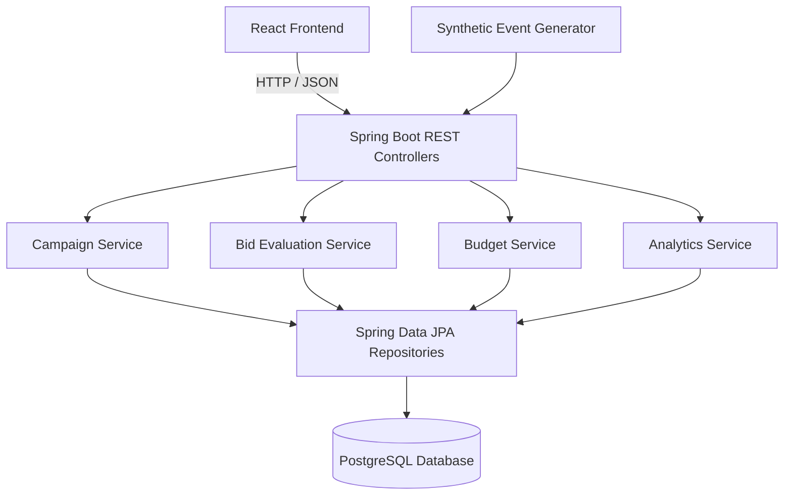

# System Architecture

## Proposed MVP Architecture

## Implementation Status

- Implemented: Spring Boot campaign creation API, JPA persistence, PostgreSQL database.
- Planned: React frontend, bid evaluation, budget accounting, analytics, and synthetic event generator.

## Architecture Principles

- Separate presentation, business logic, and persistence.
- Validate inputs and business rules on the backend.
- Use precise decimal types for monetary values.
- Keep all campaign and performance data synthetic.
- Use REST/JSON for communication between the frontend and backend.